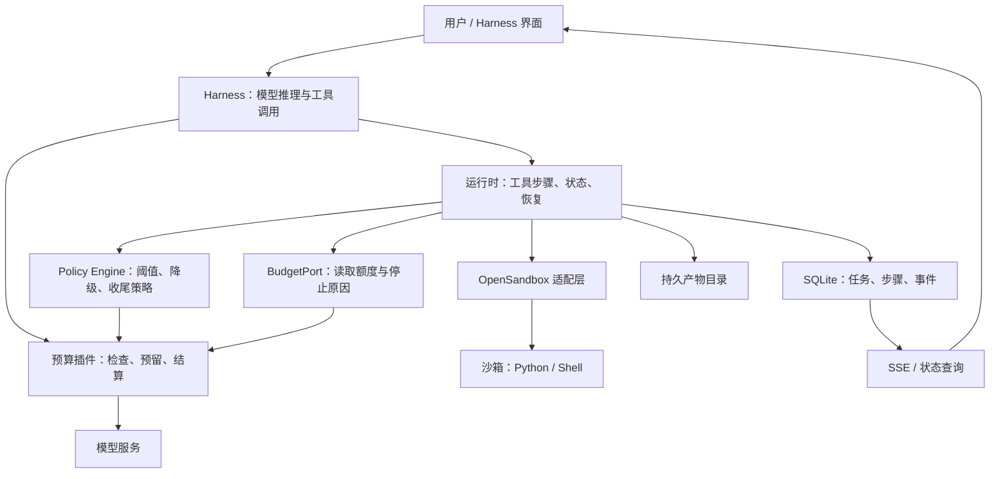

# 预算插件与 Agent 沙箱运行时：设计与完善计划

更新日期：2026-11-19

本文是设计与实施计划，不代表项目已经完成。保留原简历草稿希望实现的功能，按依赖和验收条件分期交付。本仓库包含运行时代码，原预算插件在独立 checkout 中升级。已实现与已验收范围以任务清单和 docs/evidence 为准。当前 G1—G4 与 P5-01—P5-07 已按原始验收条款留证。G5 所需的 QA-05 保留正式评测误拦截率的证据缺口。现有演示和简历项目条目可独立使用，见 [交付复核](docs/evidence/N06-delivery.md)。

## 0. 如何执行本计划

- 设计和边界以本文为准；逐项执行使用 [AGENT_RUNTIME_TASKS.md](AGENT_RUNTIME_TASKS.md)。任务编号、前置依赖、交付物和验收证据在清单中维护。
- 设计中的接口和路径以当前代码及验收记录持续校正；未勾选的任务不能当作已完成。部分接口已有本地或可控适配器验证，不能替代真实服务验收。
- 开发顺序：先验证宿主与沙箱扩展点，交付一条真实执行链，再增加原子预留、恢复和分级策略。UI、MCP 与多 Agent 后置。
- 一个任务只有在代码、针对性验证和证据记录齐备后才勾选完成。模拟适配器通过不能代替真实宿主或真实沙箱验收。
- 用户已授权实施计划。用户曾选择暂不准备沙箱环境、先完成代码，之后配置 Docker 并要求重试；当前环境证据见 P0-04 和 P0-04-isolation。有界部署检查通过不代表完整租户隔离，剩余门槛继续保留。

### 0.1 第一个可展示版本的范围

一个 Harness 根会话对应一个 run，运行时每个 run 同时只执行一个沙箱命令。模型并发与沙箱命令并发分开控制，后续并行能力在 P5 增加。

首版必须展示：固定 CSV 的正确统计及产物、实际脚本超时/取消、共享预算预留与结算、用量不确定时保守暂停、步骤恢复、分级软限制和模板收尾。采用现有宿主界面或最小命令入口展示状态即可。

首版不要求：独立前端产品、分布式调度、多租户 SaaS、任意外部副作用自动重试、Python 进程内存快照、通用 AgentScope 兼容层。原草稿中的扩展功能仍保留在 P3—P5，不作为首版阻塞项。

### 0.2 开工前需要消除的未知项

| 未知项 | 对应任务 | 验证失败时的处理 |
| --- | --- | --- |
| Harness 是否提供可靠的调用前/后、会话归属和恢复扩展点 | P0-02 | 记录具体缺口，收敛适配接口或提出小范围宿主改动，不编造可调用 API |
| 原插件如何暴露预算域且兼容原账本 | P0-03 | 先提供只读内部桥接；涉及写入的部分必须在预算插件中实现 |
| 当前机器能否启动目标 OpenSandbox 部署，是否支持所需查询/取消/限制 | P0-04 | 生命周期、受控执行及有界部署检查已通过；完整隔离与真实预算组合恢复仍需分别验证 |
| 模型服务是否返回完整、可去重的 usage，能否约束输出长度 | P0-02、P2-04 | 选择已经验证的服务配置，或进入明确的用量待核对状态；不虚构零超支能力 |
| 测试数据和结果是否可公开复现 | P0-05 | 首版只使用仓库内合成数据和确定答案 |

以上未知项按任务清单和证据持续关闭，不要求用户逐项确认后才开始实施。

## 1. 目标与已有基础

目标：在既有 DeepSeek Harness 预算插件之上，建立能够受控执行代码、保存产物、暂停并恢复任务的运行时。使用者可以知道任务做到了哪一步、用了多少额度、为什么停止，以及怎样继续。

演示任务：读取合成或脱敏的校园设备告警 CSV，计算统计结果，生成图表及报告。中途触发预算不足、代码错误或进程重启，恢复后复用已经验证的产物继续执行。

### 1.1 已核对的公开版本

- 仓库：`winter-street/dsh-plugin-agent-budget`。
- 核对基线：`28c77462aa20ceb27acc0cec99db0dea11087dbc`，package version `0.4.0`。
- 已有按根 Agent 共享额度、模型调用计量、调用限制、持久化账本与管理入口等基础；具体行为以该版本代码和测试为准。
- 该 commit 的基线按已计量用量进行调用准入，允许已经放行的调用超额完成；该基线不具备未来用量的原子预留。
- 基线软限制：`pressureText` 在已用比例达到 50% / 80% 时注入提示；配置 `degradeRatio` 后，会在剩余额度比例低于阈值时收紧输出上限，并可使用 `degradeModel`。提示与实际调用参数调整是两种机制。
- 实施后，原插件独立 checkout 已增加预留、结算和 unknown 事件；运行时也已有恢复、上下文及工作流实现和阶段测试。当前补丁版本、交付范围与真实验收缺口见 P2、P3、P4、P5 证据，不能把受控测试当作外部计量或完整任务完成。

### 1.2 交付边界

第一版采用单机、单写者，一次任务绑定一个独立的 Harness 根会话。先处理只读输入和任务目录内的文件产物；不自动执行支付、发邮件、写业务数据库等外部副作用。

TypeScript 承载插件、运行时和 OpenSandbox 适配；Python 首先作为沙箱内执行的任务代码。暂不新增独立 Python Web 后端。

## 2. 模块职责与集成方式



职责划分：

| 模块 | 拥有的状态 | 必须保证的边界 |
| --- | --- | --- |
| Harness 适配器 | 会话与 run 的关联 | 使用受支持的宿主接口，不另起一套隐形模型循环 |
| 预算插件 | 已结算量、预留量、未确认调用 | 模型调用只计量一次；任务恢复不能产生新额度 |
| Policy Engine | 阶段、触发原因、冷却时间、策略版本 | 在硬上限内调整新调用与调度，不改写实际用量、不放宽权限 |
| Runtime Core | run、step、attempt、checkpoint | 明确成功、失败和结果未知，决定恢复策略 |
| Sandbox Adapter | sandboxId、executionId、执行结果 | 控制执行、查询状态、确认取消、回收资源 |
| Artifact Store | 输入与产物文件及校验值 | 沙箱删除后，已经提交的产物仍可恢复 |
| Context Manager | 可见任务状态、摘要、实体及来源 | 遵守上下文窗口，保留任务约束与证据 |
| Event Store | 有序的可回放事件 | 先持久化再通知，断线后可补发 |

不要让模型获得修改预算、重置账本或提高沙箱权限的工具。这些是操作者通过受控入口执行的管理动作。

### 2.1 三类 ID

- `runId`：逻辑任务，暂停和恢复保持不变。
- `budgetScopeKey`：根预算域。子 Agent 共享；恢复时显式验证绑定，不根据新会话悄悄生成额度。
- `stepId / attemptId`：逻辑步骤与某一次实际执行。重试产生新 attempt，旧记录保留。

另外使用 `modelCallId`、`sandboxId`、`executionId` 和 `eventSeq` 关联计量、远端执行与界面事件。`runId` 与 `budgetScopeKey` 不等价，第一版只用一对一映射简化归属。

### 2.2 服务接口先行

下面是拟新增的内部接口，不是现有公开 API：

```ts
interface BudgetPort {
  snapshot(scopeKey: string): Promise<BudgetSnapshot>;
  reserve(request: ReservationRequest): Promise<ReservationDecision>;
  markDispatched(reservationId: string): Promise<void>;
  settle(reservationId: string, usage: NormalizedUsage): Promise<void>;
  releaseUnsent(reservationId: string, reason: string): Promise<void>;
  markUnknown(reservationId: string, reason: string): Promise<void>;
}

interface SandboxPort {
  create(policy: ExecutionPolicy): Promise<SandboxRef>;
  execute(request: ExecutionRequest): Promise<ExecutionRef>;
  inspect(ref: ExecutionRef): Promise<ExecutionStatus>;
  cancel(ref: ExecutionRef): Promise<CancelResult>;
  collect(ref: ExecutionRef): Promise<ArtifactManifest>;
  destroy(ref: SandboxRef): Promise<void>;
}
```

由预算插件的模型调用入口执行预留和结算；Runtime 不再对同一模型调用重复扣费。Runtime 通过 BudgetPort 读取状态、关联停止原因。预算接口不直接暴露为模型可调用工具。

先验证宿主是否能在调用前可靠获得根会话、请求输出上限，以及在结束后获得归一化 usage。宿主接口无法提供的字段必须显式标记，不用估算结果伪装真实 usage。

### 2.3 仓库与模块安排

采用一个运行时项目和现有预算插件仓库协作。预算插件继续拥有原账本和模型调用 hook；本目录承载运行时、薄 Harness 插件和演示。P0 核对宿主依赖后再创建包，以下均为拟定路径：

```text
src/contracts/                 统一 ID、状态、错误、端口及配置类型
src/core/                      任务状态、步骤调度、暂停/取消/恢复
src/storage/                   SQLite 仓储、迁移、事件与 checkpoint
src/artifacts/                 文件暂存、manifest、校验及提交
src/adapters/harness/          根会话映射、工具注册、模型调用关联
src/adapters/budget/           现有插件服务桥接；不另建计费账本
src/adapters/opensandbox/      创建、执行、状态查询、取消及清理
src/policy/                    软限制计算、规则状态和调度应用
src/context/                   上下文分层、裁剪、摘要及实体索引
src/tools/                     工具描述、参数校验、MCP 适配
src/workflow/                  有界串行工作流及后续分支调度
src/api/                       控制接口、状态查询、SSE
src/client/                    最小状态/产物界面，P3 再建设
config/                        配置模板和经过验证的策略 profile
examples/charging-analysis/    合成 CSV、任务描述、参考计算及预期产物
tests/                         契约、故障注入和少量真实集成验证
docs/evidence/                 按任务保存命令、版本、结果与限制
```

依赖方向：core / policy 依赖 contracts；适配器实现 contracts；宿主入口组装它们。单元测试可替换适配器；最终真实集成测试必须使用同样的接口和状态规则。

初始化时采用 TypeScript strict、Vitest 和锁文件；具体 Node、包管理器及 SDK 版本由 P0 的兼容性结果确定。先用单包加目录划分，不为尚不存在的部署单元拆大量 package。

运行数据放在独立的 `.runtime/` 可配置目录并加入忽略规则；合成 fixture 可以提交，模型密钥、原始用户文件和动态日志不提交。

### 2.4 状态所有权、持久化与一致性

预算插件账本和运行时 SQLite 是两个所有者，不做双写“同一份余额”。运行时只保存预算域及账本游标引用。模型计量事件必须先在插件账本提交，再通过稳定事件 ID 通知运行时；丢失通知可按游标重放。重复通知必须幂等。

| 运行时实体 | 最少需要的字段 / 约束 |
| --- | --- |
| runs | runId、rootSessionId、budgetScopeKey、status、outcome、deadline、policyVersion、revision；预算绑定创建后不能静默替换 |
| steps | stepId、runId、kind、required、inputHash、status、dependencyRefs；同一逻辑步骤只发布一个有效结果版本 |
| attempts | attemptId、stepId、attemptNo、dispatchIntentId、sandboxId、executionId、codeHash、status、errorCode；stepId + attemptNo 唯一 |
| checkpoints | checkpointId、runId、stepRevision、schemaVersion、配置/输入/产物引用、policyState；不保存可回滚余额 |
| artifacts | artifactId、runId、attemptId、受控相对路径、大小、SHA-256、commitState；下载根据 ID 查授权路径 |
| events | runId、eventSeq、eventId、type、payload、schemaVersion；runId + eventSeq 及 eventId 唯一 |
| policy_state | runId、stage、ruleVersion、计数器、冷却边界、通知去重键；与相关状态变更同事务 |
| commands | runId、commandId、kind、payloadHash、resultRef；重发同一命令不重复取消、恢复或审批 |
| approvals（P4） | approvalId、runId、actionHash、expiresAt、remainingUses、decision；失效或消费后不可复用 |
| budget_receipts | budgetScopeKey、ledgerSeq、modelCallId、eventId；只用于关联/去重，不替代真实账本 |

SQLite 的状态变更和对应事件在一个事务内完成。文件提交采用“暂存 -> 校验 -> 原子发布 manifest/文件 -> 数据库引用”的流程；崩溃后扫描并核对暂存/未引用文件，禁止把未验证文件当作成功产物。

单写者通过进程锁及启动检查落实；第二个写进程必须拒绝启动。不能只依靠“通常只启动一个进程”的约定。账本迁移、运行时迁移均需版本号、备份和异常恢复说明。

### 2.5 入口契约与错误分类

首版通过薄 Harness 插件或最小本地命令入口调用同一个 RuntimeService；P3 的 HTTP API 是该服务的映射，以下为拟定契约：

| 动作 | 拟定入口 | 行为 |
| --- | --- | --- |
| 创建 | createRun / POST /runs | 验证输入、预算绑定、配置版本，返回 runId |
| 查询 | getRun / GET /runs/:id | 返回权威快照、完成项、未完成项、预算引用、产物及 lastEventSeq |
| 取消 | cancelRun / POST /runs/:id/cancel | commandId 幂等；先进入 CANCELLING，再确认执行结束 |
| 恢复 | resumeRun / POST /runs/:id/resume | 验证 revision、暂停原因、原预算域及产物；不重置额度和次数 |
| 事件 | GET /runs/:id/events | SSE 只读观察；过旧游标返回明确 resync 提示，让客户端重取快照 |
| 产物 | GET /runs/:id/artifacts/:artifactId | 只提供当前 run 授权且已经提交的产物 |
| 审批（P4） | decideApproval / POST /runs/:id/approvals/:approvalId | 绑定具体动作、参数哈希及次数，重复提交不会重复执行 |

`commandId` 的 payloadHash 不同但 ID 相同应冲突拒绝；恢复还需 expectedRevision，避免两个客户端同时推进同一 run。首版接口仅面向本地，启用写接口时采用来源/认证检查，密钥不放进查询字符串。

错误需要结构化返回 `code / phase / retryable / userAction / causeRef`。至少区分 BUDGET_UNAVAILABLE、USAGE_UNKNOWN、POLICY_TOOL_BLOCKED、APPROVAL_REQUIRED、EXECUTION_TIMEOUT、CANCEL_UNCONFIRMED、ARTIFACT_INVALID、VERSION_MISMATCH。重试策略按错误类别执行，不对所有异常统一重试。

## 3. 预算插件升级：预留、结算与未知状态

### 3.1 新增预留模型

```text
可用额度 = 总额度 - 已结算用量 - 未结算预留
```

示例数据仅用于解释：总额度 10,000，已用 7,000。两个并行调用各申请预留 2,000。第一个成功后剩余可用 1,000，第二个应排队或被拒绝。第一个实际用量为 1,200，结算时移除其 2,000 预留并增加 1,200 已用，可用额度成为 1,800。

新增状态：`reserved -> dispatched -> settled`，以及 `released_unsent`、`unknown`。

`markDispatched` 在发出网络请求前持久化，语义为“开始尝试发送”，不能解释为服务端确认已接收。进程在这个标记之后崩溃，即便请求可能尚未真正发出，也先保守归为 unknown，除非有可核对证据。禁止在发送成功后才补写该标记，避免已发生消耗的请求完全失去追踪。

实施约束：

1. 检查并写入预留必须是同一原子操作，持久化成功后才能放行。优先延续既有单写者机制与账本架构，不直接宣称支持多进程分布式共享。
2. 给账本增加版本化预留事件；保持旧记录可读取，写入升级前完成回放和兼容性测试。
3. `modelCallId / reservationId` 唯一。重复结束事件和账本回放不能重复结算；与既有 sample 计量路径统一，不能同时记两笔。
4. 明确尚未发出的请求可以释放预留。已发出但结果未知的请求不能因为本地超时或重启就直接退款。
5. usage 缺失时保留未确认状态，暂停后续相关调用，提供核对入口。不能把缺失的 usage 当作 0。
6. 实际用量高于预留时，记录超额、更新真实账本并停止后续准入；不截断真实 usage 来制造预算达标。
7. 预算调整和异常核对需要审计记录。恢复任务不能调用 reset 清空既有用量。
8. unknown 预留阻止该根预算域的新模型调用；可以继续查询远端、收集已完成产物和执行清理。后到的 usage 或显式核对记录可以结算，不能因已经暂停就丢弃。
9. work / finalize 的 purpose 由宿主运行时指定和校验，模型不能自报用途来获取收尾额度。取消请求和用户关闭页面不触发自动退款。

### 3.2 预留量从哪里来

初版使用：输入 token 估计 + 已配置输出上限 + 明示的安全余量，同时对 provider 请求设置受支持的输出限制。

预估值不是精确计费值。若无法可靠界定输入、输出或 provider usage 口径，就不能承诺“绝对零超支”。应分别展示预留额、实际用量和超额量。

严格上界需要在固定模型和 provider 语义下专项验证；不把这一点作为默认已满足条件。

### 3.3 Token 与执行资源分别管理

| 预算/限制 | 含义 | 初版策略 |
| --- | --- | --- |
| Token 总量 | 多次模型调用累计消耗 | 根域共享，预留后结算 |
| 模型并发数 | 同时在途的模型调用 | 优先复用现有控制并验证释放 |
| 单次工具超时 | 一次脚本允许运行的墙钟时间 | 到期请求终止并确认状态 |
| 任务 deadline | 任务整体允许持续的时间 | 停止新步骤，清理在途执行 |
| 工具尝试次数 | 实际调度的 attempt 数 | 重试也计数，防止无限修复 |
| CPU / 内存 / 沙箱 TTL | 执行环境资源及最长存活 | 由执行策略下发并验证 |
| 文件与日志限额 | 输出量与回传量 | 限制大小、数量和日志预览长度 |

不能把 token、CPU 和秒数简单相加成一个没有单位的“总预算”。

### 3.4 软限制：开源参考及核对边界

2026-11-16 补充。以下仅借鉴设计，不要求引入这些项目作为依赖，也不把它们描述成提供同一套预算运行时。

| 来源 | 核对到的行为 | 本项目借鉴方式 |
| --- | --- | --- |
| 现有预算插件，固定 commit 见 1.1 | 50% / 80% 用量提示；可配置剩余比例触发的输出上限与模型切换 | 复用已有提示及 request hook，加入统一阶段、实际调度和审计 |
| LangChain SummarizationMiddleware 官方文档 | 支持 tokens、messages、fraction 等触发条件，并单独配置 keep | 将压缩触发点与保留范围分开配置，保护任务约束和最近有效结果 |
| LangChain ToolCallLimitMiddleware 官方文档 | `continue` 阻止超限工具并返回错误，允许模型和其他工具继续 | 局部限制单个工具，返回结构化原因和可选路径，不让整个任务直接失败 |
| Gemini CLI，commit `4ed06ed0ddc523a6d356a4ad35ddfea331041888` | 压缩默认比例为 0.5；旧工具结果有折叠逻辑，默认保护最近 3 个工具响应 turn | 先处理重复日志和历史工具输出，再按需要进行模型摘要 |
| Gemini CLI 同一 commit | 工具循环检测以名称和参数生成 key；检查长度 1—5 的循环重复 5 次；另有文本和模型辅助检测 | 第一版只做有明确证据的重复/无进展检测；不复制完整模型诊断链路 |
| OpenCode V2 官方 compaction 文档 | 通过 buffer 为上下文预留空间，keep.tokens 保留近期细节；太长后的恢复重试有界 | 上下文提前压缩，并限制失败后的重复压缩次数 |
| OpenCode V2 官方 permissions 文档 | allow / ask / deny 将自动执行、等待确认、拒绝分开 | 超出已授权策略时保存状态并请求具体确认，而不是把所有异常归为失败 |

版本差异：当前 OpenCode V2 文档明确 `doom_loop` 已不是现行权限 action；不要把旧版“三次重复调用”配置当成当前 API。研究笔记保留固定版本与来源，实施时再验证选定版本。

注意：OpenCode 的 context buffer 是单次上下文空间；本计划的收尾保留额度是任务累计 token 的分配，两者不是同一机制。

### 3.5 分级行为与阈值草案

下表数值是本项目的待评测初始配置，不是行业标准，也不是抄用其他项目默认值。新增阶段主要在下一次调用、步骤或分支开始前生效；不截断已经生成到一半的代码或工具参数。

`pressure = (已结算用量 + 未结算预留) / 总额度`，界面分别展示实际已用与在途预留。预留造成的压力和真实消耗不可混为一谈。

| 触发条件 | 建议动作 | 执行方 |
| --- | --- | --- |
| pressure >= 50% | 每阶段一次提醒；要求优先完成验收目标，减少非必要探索 | 策略层输出提示与事件，模型决定表述 |
| pressure >= 65% | 对后续调用降低并发（例如从 2 到 1）；缩短说明型输出；不再自动扩展非必要任务 | 调度器和模型请求 hook 真正执行 |
| pressure >= 80% | 聚焦必需步骤；不再自动创建新子 Agent；收紧可选检索与非必要 Reviewer 轮次 | 调度器按已记录的依赖和验收条件执行 |
| pressure >= 95%，或剩余普通额度无法容纳下一次必要调用 | 保存进度，转入收尾或暂停；允许收集现有产物、校验清单和生成受限报告 | 运行时协调预算插件 |
| 全局或分类额度无法原子预留下一次调用 | 停止该调用；模板报告进度，等待调整或结束 | 预算插件最终把关 |

50% / 80% 延续当前插件已有提醒，但计算口径升级为包含预留。新增字段用明确的 `enterUsedRatio` 等命名，避免把当前 `degradeRatio` 的“剩余比例”与新策略的“使用比例”弄反。

软限制阶段属于策略状态（normal / notice / conserve / focus / finalize），与 RUNNING、PAUSED_BUDGET 等任务生命周期分别保存。提醒是建议；并发、工具准入和输出参数调整由应用强制执行，模型不遵循提醒也不能绕过这些控制。

### 3.6 预留收尾空间，同时明确停止语义

从总预算中预先划出收尾额度，例如 5%；普通工作只能使用剩余部分，收尾额度仍属于同一总账，不额外增加总额度。

拟采用两个分类子额度 work / finalize。实际使用和预留按 purpose 归属；原子准入同时检查分类与全局上限，避免把收尾额度既从余额扣除、又计入 reservation 造成双重计算。子额度分配和调整写入持久化事件。

例如总额 30,000，work 为 28,500，finalize 为 1,500。到收尾阶段，即使还有普通额度，也不继续派生新的探索任务。finalize 仅用于受控的产物整理、必要校验或一次简短报告；不能伪装成 finalize 调用继续搜索和派生 Agent。

1,500 是示意分配，未必能容纳报告的输入加输出。收尾前仍要估计完整请求并检查预留；不足时直接用固定模板输出已完成/未完成项与产物链接，不调用模型。配置 F=0 时完全使用模板收尾。

不同阶段的规则更新为：普通额度不足但收尾额度可用，进入 finalize；全局额度耗尽、用量待核对或用户取消时，停止新的模型调用。文件落盘、状态保存和回收沙箱不消耗模型 token，但仍受其各自的时间、I/O 和权限约束。

### 3.7 其他可触发软限制的指标

| 指标与初始条件 | 软动作 | 继续条件及硬边界 |
| --- | --- | --- |
| 上下文达到模型窗口约 70%，或预计下一请求无法保留输出空间 | 首先将旧日志替换为摘要/产物引用；必要时做一次有预算的模型摘要，保留最近关键结果 | 切换模型后重新计算窗口；摘要失败不无限重试，输入仍超限则暂停该调用 |
| 单个检索工具已调用 8 次，配置上限为 10 次 | 8 次时提醒优先使用已有证据；10 次时仅阻止该工具，让其他获准步骤继续 | 必需证据缺失应标记未完成/请求调整，不能编造或降低验收标准 |
| 相同工具、规范化参数、输入版本及错误签名连续 2 次，且没有产物/状态进展 | 返回一次结构化纠偏提示，优先修改参数或方案 | 第 3 次前暂停该调用路径；需要有实质变化或明确的一次性继续指令 |
| 单次脚本已用允许时间的 80% | 提醒并保留当前日志；支持协作式保存的脚本可请求输出中间结果 | 不能保证任意进程可保存现场；到硬超时仍执行取消和确认流程 |
| 沙箱内存持续高于配额 80%，例如连续 3 个采样点 | 限制新的并行步骤；后续任务选择已实现并验证的分块算法 | 不凭提示宣称能拯救任意在途 Python 进程；资源硬配额保持有效 |
| 日志或产物累计大小达到限额 80% | 减少日志预览、采样或汇总，停止非必需大文件输出 | 达到硬上限按声明的保留策略处理；错误证据和已提交产物不能静默丢失 |
| 所有必需验收项通过，且产物清单和计算结果已经核对 | 停止可选的继续搜索与重复评审，进入收尾 | 依据可观察的校验结果和用户要求，不以模型自报置信度代替验证 |

重复检测不能只比较工具名称。同一个测试命令在代码改变后重跑是有效工作；状态轮询、批量处理不同文件和预期的暂时性重试需要工具级规则。输入内容变化、完成步骤或新验证结果应更新进展标识。

第一版不使用模型自报“进度 90%”作为强制阻断依据；以可观察的步骤状态、输入/产物版本、错误签名和计量事件为准。

### 3.8 实施细节：防抖、优先级与恢复

- 在模型请求前、工具调用前、调用结算后及执行状态采样时评估策略。使用纯函数形式的 `PolicyEngine.evaluate(snapshot, action)`，输出原因、阶段和执行参数，由各适配层应用。
- 执行顺序：检查取消/权限/账本未知等禁止条件 -> 计算软策略和可选降级 -> 重新计算最终请求的额度与上下文 -> 原子预留与最终硬限制检查 -> 持久化决策并调度。不能依据降级前的模型或参数预留。
- 同一阶段提醒只发送一次，不每个 chunk 弹窗。保存 ruleId、policyVersion、阶段、触发值、已采取动作和最后通知序号。
- 降级后回升使用滞回，例如 65% 进入 conserve，低于 60% 且至少经过一次结算边界再退出；最小间隔可先设为 2 个步骤边界。预留释放不应造成模型和并发来回切换。
- finalize 在当前任务中保持，除非操作者明确恢复探索或调整策略。进程重启保留该阶段；冷却与重试次数不因恢复归零。
- 如果压力仅由在途预留引起，且工作仍有希望继续，优先等待已有调用结算；不要立刻进行不可逆的范围缩减或要求用户充值。
- 多个规则同时命中时取约束交集，保留全部原因。审批通过只覆盖批准的那条动作，不能解除全局预算、网络/文件权限或已取消状态。
- 单次继续需要绑定动作参数哈希、额外尝试数及有效期；同一拒绝不能无限重新询问。策略许可范围内的自动降级不打断用户。
- 替换模型是可选项，默认关闭；候选模型必须验证工具调用、结构化输出、上下文窗口及任务质量。切换时重新计算 token 预留；较便宜的模型不必然更省 token 或有相同正确率。
- 缩短输出只作用于允许简化的步骤，给代码和结构化工具参数保留最小有效输出空间；遇到截断后不能用无限修复抵消节省。
- 必需校验与用户明确要求不能因预算压力被静默删除；可选工作应事先标记，删减时记录。最终结果区分“已完成”与“仅交付部分成果”。
- 任一降级、局部阻断或提前结束路径都不能跳过已发生调用的结算。策略返回的工具反馈按 toolCallId 去重；必要步骤全部被阻断且需要确认时，映射到 PAUSED_APPROVAL 并保存状态。

### 3.9 开发优先级和评测

第一批：复用已有 50% / 80% 提示，加入 65% 并发调整、原子预留后的压力计算、95% 收尾与固定模板回退。第二批：上下文阈值、单工具局部限制、重复无进展检测。第三批：资源采样、模型切换和任务类型专用策略。

先以 `observe` 模式记录“本会触发的决策”但保持原有硬限制，再以 `enforce` 模式启用软动作。固定任务、模型和预算，多次比较“仅硬上限 / 分级策略 / 分级策略加收尾保留”，记录各任务的正确率与完成情况。

核心指标：完整完成率、部分产物可用率、总 token、超额量、误拦截率、无效重复调用数、收尾成功率、额外摘要/检查开销、人工打断次数和总耗时。每项给出明确分母与失败分类；不得只报告节省 token 而隐藏任务完成率下降。

## 4. 沙箱运行时与产物管理

第一版执行路径：

1. 根据 `runId` 创建沙箱，绑定固定镜像和执行策略。
2. 将任务输入复制到指定目录；不挂载宿主根目录、Docker socket 或模型密钥。
3. 创建独立的 `step/attempt` 工作目录，记录代码哈希和输入清单。
4. 先持久化 dispatch 意图，再发起远端执行，拿到标识后记录 `executionId`。
5. 回收 stdout、stderr、退出码、耗时和产物清单。
6. 将产物复制到沙箱外的持久目录并验证校验值。
7. 在 SQLite 事务中提交步骤完成、产物索引和事件，再向上层报告成功。
8. 根据策略保留短期调试窗口或回收沙箱，TTL 处理宿主意外退出后的残留。

网络策略、非特权配置、挂载和文件限额都需要实际测试。不能把“创建容器成功”视为已完成完整安全隔离。需要检查所选 OpenSandbox 部署模式的限制，例如其公开安全指南说明的域名过滤和原始 IP 流量边界。

### 4.1 取消的两阶段语义

`RUNNING -> CANCELLING -> CANCELLED`。

UI 发出取消、客户端断开或 HTTP 超时，都不能直接证明远端命令已结束。适配层应请求取消，并查询 execution 状态；必要时回收整个任务沙箱。无法确认终止时，状态保持 `UNKNOWN / RECOVERY_REQUIRED`，不能立即重跑相同步骤。

### 4.2 产物提交规则

- 为每个 attempt 使用独立输出目录，避免失败重试覆盖成功文件。
- manifest 记录文件名、大小、校验值、产生它的 step 和 attempt。
- 只发布 manifest 中已校验的文件；拒绝逃逸路径和非预期文件类型。
- 完成后默认把脚本、结构化结果和图表一起保留，便于核对。
- 沙箱只是执行环境，不能是唯一产物存储。

### 4.3 首版部署和退出行为

P0 选择并记录一个可复现的部署 profile（宿主系统、Docker/WSL 等实际条件、服务版本、镜像 digest、网络方案）。后续测试使用同一 profile；不能把在某部署上通过的隔离测试泛化到所有后端。

每个 run 一个沙箱、同时一个远端命令。原始脚本和输入作为文件传入，通过固定 runner 运行；不把用户输入直接拼进宿主 Shell 命令。日志达到配置上限时按声明策略写摘要/截断标记，不能使后台进程因日志无人消费而悬挂。

停用插件/退出服务分两种：正常退出停止新准入、保存状态、处理在途调用并回收或标记待接管资源；崩溃后的启动核对 execution、账本 unknown 和残留沙箱。不能把“退出”处理为无条件将所有 run 标为 CANCELLED。

## 5. 任务状态、checkpoint 与恢复

### 5.1 Run 状态

```text
CREATED -> RUNNING -> SUCCEEDED
                 -> COMPLETED_PARTIAL
                 -> PAUSED_BUDGET
                 -> PAUSED_APPROVAL
                 -> PAUSED_ACCOUNTING
                 -> RECOVERY_REQUIRED
                 -> FAILED
                 -> CANCELLING -> CANCELLED
```

恢复前重新验证原预算域、权限、输入版本和依赖产物。进程重启不会延长原 deadline，也不会补充预算。

SUCCEEDED 只用于必需验收项全部通过。COMPLETED_PARTIAL 是显式结束并交付部分成果的终态；如果还允许等待加额度后继续，则保持 PAUSED_BUDGET，部分产物仍可下载。

允许 PAUSED_BUDGET / PAUSED_APPROVAL / PAUSED_ACCOUNTING / RECOVERY_REQUIRED 在各自原因解除、输入与配置验证通过后回到 RUNNING。SUCCEEDED、COMPLETED_PARTIAL、FAILED、CANCELLED 为终态，不直接重开；继续类似工作需显式创建关联的新 run，并明确预算归属，不能静默补充额度。

attempt 状态独立于 run：`CREATED -> DISPATCHING -> RUNNING -> SUCCEEDED / FAILED / TIMED_OUT / CANCELLED / UNKNOWN`。重试新建 attempt；UNKNOWN 必须先核对或记录可安全重试的依据。创建、运行及取消阶段均可能失败，不强行要求所有正常路径节点都曾发生。

deadline 保存为绝对时间；进程内时长控制使用单调计时。重启时根据原 deadline 计算剩余时间，不能把配置中的“10 分钟”重新授予任务。

### 5.2 暂停预算的默认策略

未启用分类收尾额度时，预算不足即停止新的模型调用和需要新规划的步骤。已经准入的模型调用继续收尾并结算；在既定超时内运行的只读沙箱步骤允许完成并收集产物。若触发用户取消、任务 deadline 或策略违规，则进入取消流程。

启用 3.6 的分类额度后，“普通工作额度不足”先尝试进入 finalize；只有在同一总额内成功预留收尾调用时才允许调用模型。全局不足或用量待核对时仍停止新的模型调用。

进入硬暂停状态时使用固定模板告知用户完成进度、原因和已有产物，不额外暗中调用模型生成“最后一条回复”。增加额度后在原 budgetScopeKey 中继续，保留调整历史。

### 5.3 checkpoint 保存内容

保存 run/step/attempt 状态、预算域引用、输入及代码哈希、已提交产物、可见任务计划、上下文摘要、执行配置版本和最近事件序号；同时保存软限制阶段、规则版本、通知去重键、冷却边界和重复/重试计数。

预算账本仍由预算插件拥有。checkpoint 中的额度快照仅供展示，不能覆盖真实累计用量。

第一版恢复的是步骤与文件，不承诺恢复 Python 内存、进程调用栈、活动连接或模型内部推理状态。

### 5.4 重启后的处理

| 发现的状态 | 处理 |
| --- | --- |
| 步骤完成且产物校验通过 | 复用，进入下一步 |
| 远端 execution 仍运行 | 重新查询/接管，或按策略取消 |
| 远端已完成但本地未提交 | 收集结果后补提交，不重新执行 |
| 已记录 dispatch，但是否启动不明 | 标记结果未知；核对远端、回执与任务目录 |
| 沙箱丢失且步骤无外部副作用 | 明确记录新 attempt，从持久输入重建 |
| 存在外部写入且结果不明 | 暂停并请求核对，不自动重试 |
| 原预算域无法恢复 | 暂停，不分配新预算绕过限制 |

本地数据库与远端沙箱之间没有跨系统事务。依靠 durable intent、唯一 attempt、远端状态核对和结果提交处理故障窗口。初版不宣称任意工具具备 exactly-once 执行语义。

## 6. 上下文功能：保留原草稿，但与预算明确区分

Token 总预算约束任务累计用量；上下文窗口预算约束单次请求输入。两者分别计算。

按以下类别组织上下文：

- system：固定指令和权限边界，由应用控制，不允许工具结果改写。
- task：用户目标、验收条件、输入引用和当前进度。
- scratchpad：可见计划、待办和中间结论，不依赖存储模型内部思维过程。
- tool result：结构化结果、日志摘要、错误和产物引用。
- history summary：历史对话摘要及覆盖范围。
- entities：关键实体、属性和原始证据引用。

第一阶段保留任务目标、约束、最近关键工具结果和产物索引，裁掉重复日志；摘要调用同样经过预算插件计量。预算不足时使用确定性裁剪，不能为压缩上下文无限消费模型调用。

第二阶段增加实体索引和查询，只把与当前步骤有关的实体放回上下文。工具结果按不可信数据处理，不能提升为 system 指令。

验收：固定长任务上比较正确率、总 token、压缩调用开销与恢复成功率，而不是只比较输入文本是否变短。

## 7. 工作流、工具、MCP、SSE 与插件交付

### 7.1 多 Agent 工作流

先实现串行 Planner -> Executor -> Reviewer。Reviewer 具有具体检查项和最大修正次数；优先用程序验证可确定的统计结果与文件完整性。

之后再加入并行、条件分支和人工确认：

- 子 Agent 继承同一根预算域；可设置子任务上限，但不能重复发放额度。
- 并行分支使用独立工作目录或沙箱，合并时验证产物，不能无锁写同一个文件。
- 重试是新的 attempt，需要预算与次数检查；不重试用户取消和未经批准的外部副作用。
- 人工确认记录具体动作、参数/计划哈希和有效期。参数变化后原批准失效。
- 审批等待期间保存状态并按策略释放沙箱，避免占用环境；恢复时重新验证条件。

AgentScope 放在后续适配或对照验证阶段，先复用 Harness 的能力；不为列技术栈而再建设一套重复的模型循环。

### 7.2 Tool Registry 与 MCP

统一工具描述、JSON Schema、风险类别、超时、重试策略、输入/输出和调用记录。

MCP 阶段实际对接至少一个服务，验证能力协商、工具发现、工具调用、错误和取消等适用行为，不能仅凭 JSON Schema 校验宣称兼容 MCP。

区分宿主执行的 MCP 工具与沙箱内工具。宿主 MCP 调用并不会自动获得沙箱的网络和文件权限限制，必须单独授权和审计。

### 7.3 SSE 与 trace

事件至少包括：run.started、step.started、tool.log、artifact.created、budget.updated、run.paused、run.resumed、run.failed、run.completed。

软限制新增 policy.triggered、policy.changed、policy.released 和 run.finalizing，附触发条件、实际指标、采取的动作和继续条件。界面区分预警、能力收紧、等待确认与硬停止。

- run 内事件序号单调递增，先持久化再推送。
- 状态变更和对应事件在同一个 SQLite 事务中提交。
- 支持快照查询及按 Last-Event-ID 补发；客户端按事件 ID 去重。
- 日志高频事件批量/限量处理，避免冲垮持久化和浏览器。
- SSE 是过程展示渠道，关闭浏览器不等于取消任务；取消使用独立命令接口。
- trace 串联 run、step、attempt、模型调用和 execution 标识，敏感配置不写入日志。

### 7.4 宿主插件及复现交付

提供配置化启停、固定依赖版本、环境检查、示例任务和可重复启动方式。先验证 Harness 的实际扩展点，再确定最终工具与界面接口。

插件停用时停止准入、完成必要持久化并处理在途任务。不能只卸载工具注册而遗留失去管理的沙箱。

## 8. 分阶段完善计划

| 阶段 | 交付内容 | 验收门槛 |
| --- | --- | --- |
| P0 基线与接口验证 | 固定插件/宿主/SDK版本；跑现有测试；验证调用关联、usage、沙箱创建执行取消 | 一次模型调用能关联到预算域；一次脚本能关联到 run；已知接口缺口形成记录 |
| P1 端到端执行闭环 | BudgetPort 只读适配、Python 工具、策略、日志、产物、run/step/attempt | 一个固定任务产出可核对结果；超时和取消行为真实可观测 |
| P2 预算预留与执行恢复 | 版本化预留账本、结算去重、未知状态、checkpoint、远端核对；预算分级策略与分类收尾额度 | 并发不会重复占用同一份可用额度；重启不重置账本；已完成步骤可复用；收尾不超出同一总额 |
| P3 交互与上下文 | SSE 补发、状态与产物界面、分层上下文、摘要、窗口预算；阈值压缩与策略原因展示 | 页面重连状态正确；长任务保持约束；压缩开销计入总预算；策略不反复触发 |
| P4 工具和编排扩展 | Tool Registry、一个 MCP 集成、串行多 Agent、有限重试与审批；工具局部限制与无进展检测 | 工具权限与执行位置清楚；审批可核对；共享根预算有效；正常重试不被误判为死循环 |
| P5 进阶能力与交付 | 实体检索、并行/条件分支、AgentScope 适配评估、启停与一键演示；资源采样与可选模型降级 | 用固定任务证明增益，提供复现说明和故障演示，报告完成率与节省的权衡 |

第一版对外展示目标为 P1 + P2；完成 P3 后再整理更完整的应用演示。后续阶段可以根据评测价值调整，不为了完成清单引入无收益的复杂度。

### 8.1 阶段门槛和演示版本

| 门槛 | 必须满足 | 对应任务 |
| --- | --- | --- |
| G0 可开发 | 固定基线、宿主接口证据、账本扩展边界、合成 fixture、最小脚手架齐备；环境缺口明确记录 | P0-01—P0-06；沙箱环境未通时后续真实门槛仍阻塞 |
| G1 可执行 v0.1 | 真实 Harness -> 工具 -> 沙箱 -> 可核对产物；真实取消/超时；原预算限制确实生效 | P1-01—P1-08、QA-02 |
| G2 可恢复 v0.2 | 原子预留与去重、未知用量保守处理、持久化恢复、软策略、收尾和故障演示全部达标 | P2-01—P2-12、QA-03 |
| G3 可观察 v0.3 | 控制接口/SSE/最小界面、分层上下文和有界摘要；断线重连与调用计量正确 | P3-01—P3-06、QA-04 |
| G4 可扩展 | MCP、局部工具限制、重复检测、审批、串行三角色工作流及共享预算验证 | P4-01—P4-07 |
| G5 完整演示 | 并行分支、实体检索、资源策略、适配评估及复现文档；提供完整对照评测 | P5-01—P5-07、QA-05 |

首版简历证据以 G2 为目标。G1 只能描述已验证的执行和限制，不能提前写恢复、原子预留或软策略成效。AgentScope 是否进入最终技术栈由 P5-05 的实际适配结果决定。

### 8.2 执行与验收约定

- 每个任务最多覆盖一个可以独立审阅的行为单元；遇到宿主改动或较大迁移时，按相同任务编号补子清单，不把未验收部分一起勾选。
- `pnpm typecheck`、`pnpm test`、`pnpm build` 等命令已在 P0-06 建立；构建包含客户端静态资源。后续测试和交付状态以任务清单及 `docs/evidence/` 的实际运行记录为准。
- 单元/契约测试使用可控 fake provider 和 fake sandbox，避免运行普通测试时调用真实模型。真实 smoke 和 integration 单独显式执行，记录环境、模型、token 和命令。
- 预算、状态转换、恢复、取消、审批和产物提交需要针对性测试；文档/UI 样式调整只做合适的检查，不追求无意义的测试数量。
- 每项证据记录：任务 ID、实现 commit、依赖版本、验证命令与退出码、输入 fixture、结果、已知限制。失败记录不能被后续成功覆盖删除；不得把预期结果写成实测结果。
- 原插件升级前先备份旧账本，完成迁移回放；新版本写入后旧版本不再被允许继续写。降级必须停写并采用经过说明的备份恢复流程，不能直接让旧代码忽略新记录。
- 如变更阈值或任务成功标准，更新配置版本、计划和评测口径，再重跑受影响场景；不在同一比较中混用不同验收标准。

### 8.3 需求到任务的对应

| 需求 | 实现任务 |
| --- | --- |
| 根预算域、插件接入与模型调用关联 | P0-02、P0-03、P1-06、P2-04 |
| 原子预留、实际结算、unknown 和账本迁移 | P2-01—P2-04 |
| 沙箱策略、执行、日志、产物、超时和取消 | P0-04、P1-03—P1-08 |
| checkpoint、执行核对、重启恢复 | P2-05—P2-07 |
| 软限制、分类收尾、策略观测及恢复 | P2-08—P2-12 |
| SSE、trace、控制接口与最小界面 | P3-01—P3-03 |
| 分层上下文、裁剪、摘要与实体检索 | P3-04—P3-06、P5-03 |
| Tool Registry、JSON Schema、MCP | P1-01 的最小契约、P4-01、P4-02 |
| 工具局部限制、无进展检测 | P4-03 |
| 人工确认、串行工作流、条件分支和并行 | P4-04—P4-07、P5-01、P5-02 |
| 沙箱资源软限制和可选模型切换 | P5-04、P5-06 |
| AgentScope、配置启停、一键复现 | P5-05、P5-07 |
| 测试设施、故障注入、对照评测与简历证据 | QA-01—QA-05 |

## 9. 必测场景

以下是待编写的测试与演示，不是已通过结果。

| 场景 | 预期 |
| --- | --- |
| 两个调用争用最后一份额度 | 原子预留只允许符合余额的调用进入 |
| 相同 usage 重复到达 | 只结算一次 |
| 请求未发出即失败 | 有证据地释放预留 |
| 请求发出后本地失联 | 保持未知状态，不自动退款 |
| 实际用量超过预留 | 记录真实用量和超额，停止后续准入 |
| 重启与账本回放 | 用量、预留及未确认记录一致 |
| 新会话恢复旧任务 | 仍绑定原预算域 |
| 脚本正常、异常、超时 | 退出与错误分类正确，产物提交规则一致 |
| 取消请求成功但远端仍运行 | 保持取消中或未知，不能假报已取消 |
| 远端完成后宿主在提交前崩溃 | 核对并补提交，避免盲目重跑 |
| 成功产物已提交后重启 | 校验并复用，不重复覆盖 |
| 预算不足但有脚本在运行 | 按固定策略收尾，保存产物，暂停后续模型调用 |
| 域名/IP外联、危险挂载与越界路径 | 验证部署实际边界，失败项不写为已实现限制 |
| SSE 断线并重连 | 补齐事件，顺序稳定且不重复展示 |
| 工具输出包含指令性文本 | 不改变权限、预算和系统策略 |
| 审批后参数被修改 | 原批准不再适用 |
| 并行分支与 Reviewer 重试 | 不突破总次数、并发和共享额度策略 |
| 预留使压力瞬时升高，结算后下降 | 按滞回和结算边界处理，不频繁切换模型/并发或重复提醒 |
| 触发软限制后进程重启 | 恢复阶段、通知记录和冷却/重复计数，不重复请求审批 |
| 普通额度耗尽，但收尾额度可用 | 只运行被允许的收尾动作，全局额度不增加 |
| 收尾额度不足以覆盖输入加输出 | 使用模板交付现有成果，不绕过预算调用模型 |
| 模型切换或输出限额变化 | 重新计算请求和预留，拒绝不兼容的工具/结构化输出配置 |
| 摘要失败或未减少上下文 | 有界处理，不不断消耗预算反复压缩 |
| 单工具被限流或限次 | 其余获准工具继续；必需证据缺失时准确标记未完成 |
| 修改代码后重复运行相同测试 | 识别输入版本变化，不按无进展循环阻断 |
| 用户批准一次继续，但全局预算不足 | 仍不能调用，不以审批覆盖硬上限 |
| 预算紧张但必需校验未完成 | 不报告全任务成功，不静默跳过验收标准 |
| 必需验收项全部通过但 Agent 继续可选探索 | 进入收尾，不通过额外评审无限延长任务 |
| 局部阻断或提前结束与计量同时发生 | 已发生调用仍被结算，工具反馈不重复，恢复后累计用量不丢失 |

## 10. 评测与简历证据

先选少量确定答案的固定任务，再扩展到例如 20 个任务的演示集。固定输入、模型配置和运行环境，记录成功标准及失败分类。

建议对比基线和增强版：任务完成率、恢复成功率、重复执行次数、累计 token、超额量、端到端耗时、取消确认延迟、产物一致性和残留沙箱数量。摘要、Reviewer、重试都纳入消耗，不遗漏辅助调用。

预算模式变化会影响完成率，应同时报告“更少超额”和“是否更容易提前暂停”，不只挑有利指标。

每一项未来简历表述应对应：实现入口、测试场景、演示录屏和可复现结果。完成前不写“实现原子预扣”“支持任务恢复”“兼容 MCP”“支持并行工作流”等已完成式表述。

## 11. 资料与核对范围

以下是设计时核对的公开主源。预算插件使用上文 commit 固定基线；其他主分支内容可能变化，实施 P0 时需要固定实际依赖版本。

- 预算插件设计：`https://github.com/winter-street/dsh-plugin-agent-budget/blob/28c77462aa20ceb27acc0cec99db0dea11087dbc/docs/design.md`
- 预算插件实现：`https://github.com/winter-street/dsh-plugin-agent-budget/blob/28c77462aa20ceb27acc0cec99db0dea11087dbc/src/index.ts`
- OpenSandbox JavaScript SDK：`https://github.com/opensandbox-group/OpenSandbox/blob/main/sdks/sandbox/javascript/README.md`
- OpenSandbox 命令接口：`https://github.com/opensandbox-group/OpenSandbox/blob/main/sdks/sandbox/javascript/src/services/execdCommands.ts`
- OpenSandbox 网络边界：`https://github.com/opensandbox-group/OpenSandbox/blob/main/docs/guides/network-security.md`
- MCP 工具规范参考：`https://modelcontextprotocol.io/specification/2025-11-25/server/tools`
- SSE 标准：`https://html.spec.whatwg.org/multipage/server-sent-events.html`
- LangChain 摘要及调用限制：`https://docs.langchain.com/oss/python/langchain/middleware/built-in`
- Gemini CLI 压缩实现：`https://github.com/google-gemini/gemini-cli/blob/4ed06ed0ddc523a6d356a4ad35ddfea331041888/packages/core/src/context/chatCompressionService.ts`
- Gemini CLI 循环检测：`https://github.com/google-gemini/gemini-cli/blob/4ed06ed0ddc523a6d356a4ad35ddfea331041888/packages/core/src/services/loopDetectionService.ts`
- OpenCode V2 上下文压缩：`https://opencode.ai/docs/compaction/`
- OpenCode V2 权限：`https://opencode.ai/docs/permissions/`

上述资料是设计依据，不代表运行验证。实施阶段已运行原预算插件检查、受控 Harness 组合、真实 OpenSandbox 执行及恢复探针；准确范围和未完成项以 `AGENT_RUNTIME_TASKS.md`、`docs/evidence/` 为准，不能将受控模型当作外部模型验收。
