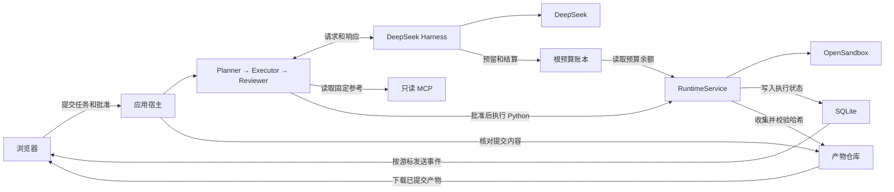

# Agent 沙箱与预算运行时 · 简历及演示材料

## 简历项目经历

**Agent 沙箱与预算运行时** ｜ 独立开发 ｜ TypeScript、Python、DeepSeek Harness、OpenSandbox、SQLite、MCP、SSE

- 将预算插件接入 DeepSeek Harness，按模型调用预留、结算和核对 token。Planner、Executor、Reviewer 共享根预算，分级策略可限制后续工具或模型调用，并预留任务收尾额度。
- 使用 OpenSandbox 执行 Python 分析任务，记录命令、退出码与产物哈希。通过 SQLite 保存运行进度和远端执行标识，实测 worker 被强制终止后恢复同一次执行，补交已生成的产物。
- 实现上下文预算、摘要与检查点，保留原任务约束和产物引用。浏览器通过 SSE 游标补取事件，支持中断后继续查看进度和下载结果。
- 实现 Planner → Executor → Reviewer 串行流程，接入只读 MCP、工具参数校验与一次性人工批准。真实模型与沙箱联调通过，宿主独立校验并交付任务产物。

如需突出评测和性能，可用下面一条替换最后一条，面试时用实测分母和日志说明结论。

- 搭建真实模型与沙箱的双 worker 分片评测，按槽位、配置指纹和 SQLite 提交记录合并。3 个任务 × 3 种预算策略 × 3 次重复均完整交付，独立核对 63 份产物。单次 9 槽对照的墙钟时间由 155 秒降到 86 秒。

软限制也可以作为追问案例。真实 OpenSandbox 资源探针通过 14 项检查，连续两次 CPU 或内存高值将后续派发上限从 2 降到 1，连续两次低值恢复，在途命令正常完成。详见 [实测记录](evidence/N05-evaluation.md)。

## 请求如何走到交付

## 五分钟演示

1. 在本地启动 OpenSandbox，按环境说明填写 `.env.local`，运行 `powershell.exe -NoProfile -ExecutionPolicy Bypass -File .\scripts\run-demo.ps1`。命令使用仓库的合成 CSV。参见 [运行环境](environment.md) 和 [演示说明](demo.md)。
2. 打开新运行目录中的 `delivery/report.md`、`delivery/chart.svg` 和 `delivery/statistics.json`。用 `demo.json` 中的独立校验结果与产物哈希展示交付依据。
3. 对照 `trace.json` 和 `ledger.json` 讲解一次模型调用何时预留、何时结算，以及执行超时和用量未知时各自进入什么状态。用固定崩溃窗口记录说明恢复方法。参见 [进程恢复验收](evidence/N02-budget-process-recovery.md)。
4. 想演示浏览器重连和审批时，分别使用 `scripts/run-n03-long-task.ps1` 和 `scripts/run-n04-real-serial.ps1`。前者验证上下文压缩、SSE 重连和下载，后者验证三个角色、只读 MCP、一次性批准和产物清理。参见 [长任务验收](evidence/P3-06.md) 和 [真实串行验收](evidence/N04-real-serial.md)。

2026-11-19 的同机新源码目录复现中，真实 DeepSeek 和 OpenSandbox 运行 17.342 秒，使用 4065 tokens，三份交付均通过独立验证。该数字来自一次固定样例，可以在演示时对照产物和账本。见 [复现证据](evidence/P5-07.md)。

## 面试追问与证据

| 可能的追问 | 讲解思路 | 代码与验收 |
| --- | --- | --- |
| 为什么保留单 Agent 模式？ | 同一固定简单任务中，单 Agent 用时 13.702 秒、2057 tokens，三角色用时 15.454 秒、6797 tokens，双方产物字节一致。按任务复杂度选择编排，说明额外角色的审核成本。每模式各一个真实样本。 | [真实固定对照](evidence/N04-comparison.md) |
| 多角色怎样共享预算？ | 模型请求前在根预算预留，收到用量后按调用 ID 结算。未收到用量时保留预留和核对状态。软限制约束后续动作，收尾额度单独预留。 | [预算适配器](../src/adapters/budget/index.ts)、[受控及外部传输观察](evidence/N01-fault-matrix.md) |
| 沙箱断线后如何恢复？ | 先按原远端执行标识核对。同一 attempt 可补交已发布的产物。创建结果未知时保留待核对状态，只有具备适配器的未发送证明才允许重试。 | [RuntimeService](../src/core/service.ts)、[进程恢复验收](evidence/N02-budget-process-recovery.md)、[沙箱创建契约](evidence/N04-sandbox-creation-recovery-design.md) |
| 压缩是否会丢任务约束？ | 原任务和权限边界作为必需上下文保留。较早历史可以生成带来源的摘要。窗口装不下必需内容时暂停。两份真实摘要做了源文对照。 | [上下文组装](../src/context/assembler.ts)、[长任务验收](evidence/P3-06.md) |
| 怎样知道交付正确？ | 独立读取输入并重算统计，校对 Markdown 内容和 SVG 标签及几何。失败产物用于定位问题，版本化提示后再用新目录复测。 | [产物验证器](../eval/artifact-validation.ts)、[N05 实验](evidence/N05-evaluation.md) |

历史正式评测记录了 180 个槽位，其中 177 个完整交付，3 个部分交付。AgentScope 当前为适配评估。真实运行证据覆盖固定任务与故障窗口，计量采用 token 单位。简历量化时采用已核对的运行范围和分母。参见 [历史评测](evaluation.md)、[任务清单](next-steps.md) 和 [N06 版本与复现记录](evidence/N06-delivery.md)。
